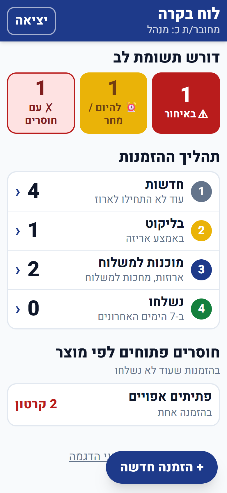
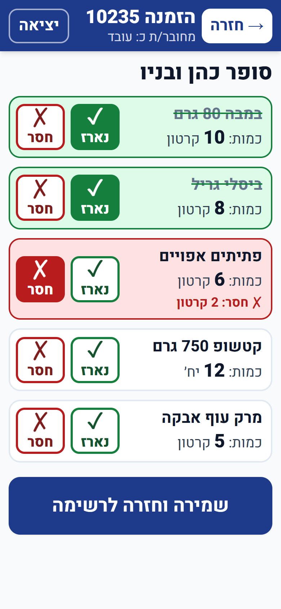
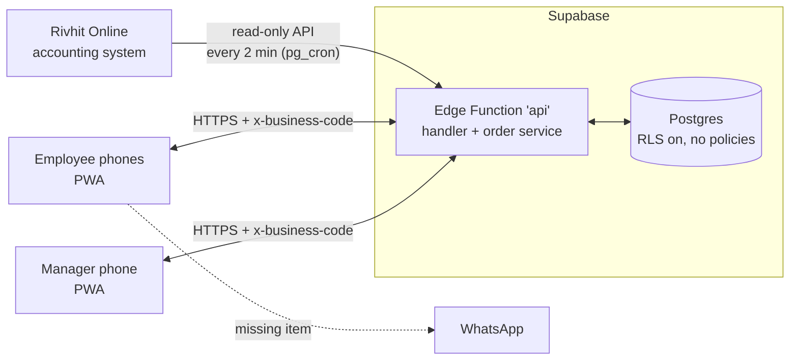

<div dir="rtl">

## ניהול הזמנות למחסן

אפליקציית PWA בעברית לטלפון, לליקוט ואריזה של הזמנות במחסן. ההזמנות נמשכות אוטומטית מרווחית אונליין (קריאה בלבד), העובדים מסמנים כל פריט כ"נארז" או "חסר", חוסר נשלח בוואטסאפ, והמנהל רואה לוח בקרה עם הזמנות באיחור, להיום/מחר ועם חוסרים. אפשר להריץ במצב הדגמה בלי שרת בכלל.

</div>

---

# Warehouse Orders PWA

A mobile-first, Hebrew (RTL) progressive web app for packing customer orders in a small warehouse.
Orders are imported automatically from the **Rivhit Online** accounting system (read-only), employees tick
items off on their phones, missing items are reported over **WhatsApp**, and the manager gets a live
dashboard of what is late, due soon or short.

**Live:** https://pelecar-delivery-app.netlify.app (requires a business code, so no data is exposed)
**Try it without any backend:** `npm install && npm run dev` (demo mode, sample data in your browser).

## Screenshots

| Entry | Manager dashboard | Employee: active orders | Packing checklist |
|---|---|---|---|
|  |  |  |  |

## Features

- **Two roles.** Employees see the orders to pack; the manager sees a dashboard and every order.
- **Packing checklist.** Big touch targets: each line is *packed* or *missing* (with a partial quantity).
- **Order pipeline.** New → picking → ready to ship → shipped, plus late / due today-tomorrow / with-shortages counters.
- **Deadlines in business days.** Delivery dates follow the Israeli work week (Sunday to Thursday), computed in the Asia/Jerusalem time zone on both phone and server.
- **Live import from Rivhit Online.** A scheduled job pulls open orders every 2 minutes. Orders closed in Rivhit
  (delivery note / invoice issued) are marked shipped; cancelled orders are flagged to the manager. The app never writes to Rivhit.
- **WhatsApp for shortages.** "Missing" opens WhatsApp with a ready-made message, optionally straight to the manager's chat.
- **Multi-phone sync.** Phones poll a version number every 15 s and refresh immediately when the app comes back to the foreground.
- **Installable PWA** with auto-update via a service worker.
- **Demo mode.** With no API configured, an in-browser repository with seed data powers the whole UI.

## Tech stack

| Layer | Tools |
|---|---|
| Front end | React 18, TypeScript, Vite 5, Tailwind CSS 3, Zustand, React Router, vite-plugin-pwa |
| Back end | Supabase Edge Function (Deno) + Postgres, `pg_cron` / `pg_net` for the scheduled sync |
| Integrations | Rivhit Online API (read-only), WhatsApp deep links |
| Tests | Vitest (business days, WhatsApp messages, manager view, API handler, Rivhit sync) |
| Hosting | Netlify (static app), Supabase (API + database) |

## Architecture



The same server code (`supabase/functions/_shared/`) runs in three places: the Supabase Edge Function,
a local Node dev server with an in-memory database, and the test suite.

| Path | What |
|---|---|
| `src/screens/` | Entry, code screen, employee screens, manager screens |
| `src/data/repository.ts` | Picks `mockRepository` (demo) or `apiRepository` (live) from `VITE_API_URL` |
| `src/data/seed.ts` | Demo data |
| `src/lib/` | Business days, order rules, manager view, WhatsApp message builder |
| `src/i18n/he.ts` | All on-screen text |
| `supabase/functions/_shared/` | Order service, Rivhit import, HTTP handler, business days |
| `supabase/functions/api/` | Edge Function entry + Postgres adapter |
| `supabase/migrations/` | Schema and the sync schedule |
| `server/` | Local dev server, fake Rivhit, server tests |

## Run locally

Requires Node 20+. In Windows PowerShell use `npm.cmd` / `npx.cmd`.

```bash
npm install
npm run dev        # demo mode: sample data stored in this browser only
npm test           # unit + API tests
```

**Full stack on your machine (no Supabase needed):**

```bash
cp .env.server.example .env.server   # business code for the local API (demo value 1234)
cp .env.live.example .env.live       # points the app at the local API
npm run server                       # API on :8787 with a fake Rivhit that creates sample orders
npm run dev:live                     # the app, talking to that API
```

Add `RIVHIT_API_TOKEN` and `RIVHIT_ORDER_DOC_TYPE` to `.env.server` to read your real Rivhit orders (read-only).
`npm run rivhit:types` lists your Rivhit document types so you can find the number used for orders.

## Deploy

1. Create a Supabase project and link it: `npx supabase login`, then `npx supabase link --project-ref <your-project-ref>`
   (also set `project_id` in `supabase/config.toml`).
2. Replace `<your-project-ref>` in `supabase/migrations/20261014000000_rivhit_sync_schedule.sql`, then run `npx supabase db push`.
3. Deploy the function: `npx supabase functions deploy api --no-verify-jwt`.
4. Set the function secrets: `BUSINESS_CODE` (a long random code), and optionally `RIVHIT_API_TOKEN` and `RIVHIT_ORDER_DOC_TYPE`.
5. `cp .env.production.example .env.production`, set `VITE_API_URL`, then `npm run build` and deploy `dist/` to any static host
   (`public/_redirects` handles SPA routing on Netlify).

The sync job can be paused and resumed with the migrations in `supabase/migrations/`.

## Security notes

- Every API call needs the shared business code (entered once per phone). `/sync` can be triggered anonymously but returns nothing.
- Row Level Security is enabled with no policies, so the public Supabase key cannot read the tables directly.
- No secrets live in the front end. `.env*` files are git-ignored and only `*.example` files are committed.

## License

[MIT](LICENSE)
