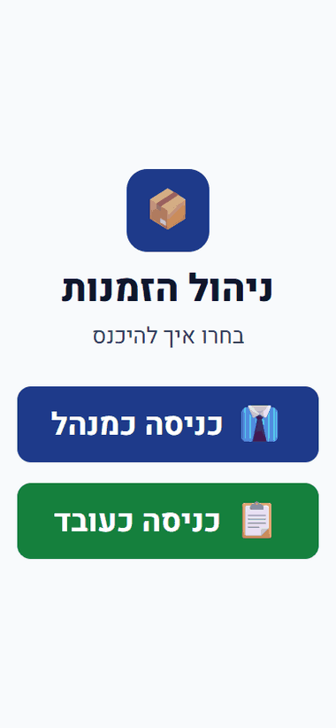
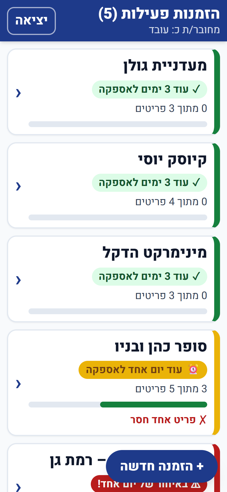
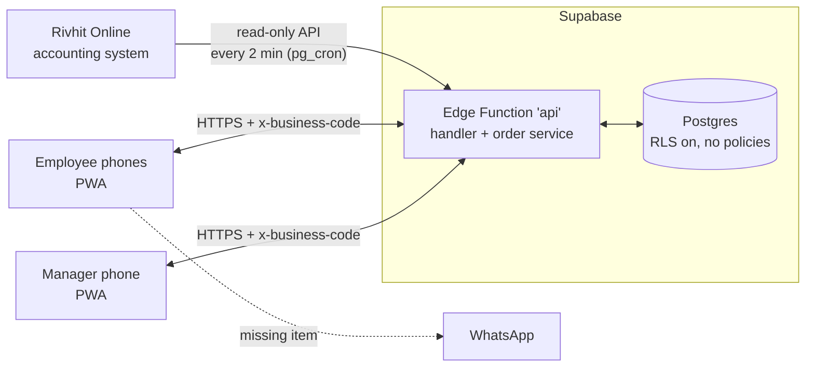

<div dir="rtl">

## ניהול הזמנות למחסן

אפליקציית PWA בעברית לטלפון, לליקוט ואריזה של הזמנות במחסן. ההזמנות נמשכות אוטומטית מרווחית אונליין (קריאה בלבד), העובדים מסמנים כל פריט כ"נארז" או "חסר", חוסר נשלח בוואטסאפ, והמנהל רואה לוח בקרה עם הזמנות באיחור, להיום/מחר ועם חוסרים. אפשר להריץ במצב הדגמה בלי שרת בכלל.

האפליקציה פותחה עבור המחסן בחברה של אבי ופותרת שתי בעיות תפעוליות. הראשונה: לא היה מעקב מסודר אחר כל הזמנה, ובתקופות עמוסות הזמנות נשכחו או התעכבו, תלוי בערנות של עובד המחסן. השנייה: העובד התמודד מדי יום עם מעקב ידני אחר כל פריט בכל הזמנה ועם עדכון המנהל על פריטים חסרים. היום כל הזמנה נכנסת אוטומטית ממערכת ה-ERP, העובד מסמן כל פריט כנארז או חסר, והמנהל מקבל התראה מיידית ותמונת מצב של כל ההזמנות.

</div>

---

# Warehouse Orders PWA

[](https://github.com/roeiraz12/warehouse-orders-pwa/actions/workflows/ci.yml)
[](https://github.com/roeiraz12/warehouse-orders-pwa/actions/workflows/pages.yml)
[](LICENSE)

### [▶ Try the live demo](https://roeiraz12.github.io/warehouse-orders-pwa/)

The demo runs entirely in your browser with sample data (no backend, no sign-in); best viewed on a phone or in
your browser's mobile view. The production deployment (https://pelecar-delivery-app.netlify.app) is connected to
the real backend and requires a business code, so no data is exposed.

A mobile-first, Hebrew (RTL) progressive web app for packing customer orders in a small warehouse.
Orders are imported automatically from the **Rivhit Online** accounting system (read-only), employees tick
items off on their phones, missing items are reported over **WhatsApp**, and the manager gets a live
dashboard of what is late, due soon or short.

<p align="center">
  
  <br>
  <em>Demo mode: enter as manager → dashboard → open a new order → mark items packed and report a partial shortage (which opens a ready-made WhatsApp message).</em>
</p>

## Case study

### Background

Built for the warehouse at my father's company to solve two operational problems. First, there was no reliable tracking per order: during busy periods orders were forgotten or delayed, depending on how alert the warehouse worker was. Second, the worker had to track every item of every order by hand and keep the manager updated about missing items. Now every order flows in automatically from the ERP, the worker marks each item as packed or missing, and the manager gets an instant alert and a live overview of all orders.

### Users

- **Warehouse employees** packing orders on their phones, often with full hands, in Hebrew. They need big
  touch targets, very few screens and zero training.
- **The manager**, who needs to see at a glance what is late, due today or tomorrow, or short, and to react to
  orders that were closed or cancelled in the accounting system.

### My role

Sole developer: I designed and built the product end-to-end, from mapping the warehouse workflow with the
business, through UX for non-technical Hebrew-speaking users, to the front end, the Supabase back end, the
Rivhit integration, deployment and tests.

### Key technical decisions

- **Read-only ERP sync.** Rivhit stays the single source of truth for what was ordered and invoiced; the app
  only reads open order documents (a scheduled `pg_cron` job every 2 minutes) and keeps the packing state in
  its own database. A bug in the app can never corrupt the accounting data, and the integration needs no
  write permissions. Changes made in Rivhit still flow in: an order closed by a delivery note or invoice is
  marked shipped, and a cancelled order is flagged to the manager.
- **PWA instead of a native app.** Installs from a link on any phone, no app-store review, one code base, and
  updates reach every phone automatically: the service worker takes over and the page reloads onto the new
  version, re-checking whenever the app returns to the foreground, since phones keep it open for days.
- **Business-code auth + Row Level Security.** For a few employees sharing phones, personal accounts were
  overhead nobody would use. Every API call carries a shared business code (entered once per phone) that the
  Edge Function verifies. Postgres has RLS enabled with **no policies**, so the public Supabase key cannot read
  the tables directly; only the function can.
- **Demo mode via the repository pattern.** The UI talks to one `OrdersRepository` interface. Without
  `VITE_API_URL` it gets `mockRepository` (seed data in the browser); with it, `apiRepository`. This let the UI
  be built before the back end existed, and it powers the public demo with no real data exposed.
- **One server core, three hosts.** The order service, Rivhit import and HTTP handler in
  `supabase/functions/_shared/` run unchanged in the Supabase Edge Function (Deno), in a local Node dev server
  with an in-memory database and a fake Rivhit, and in the test suite.
- **Business-day logic.** Deadlines are counted in Israeli business days (Sunday to Thursday) and always
  computed in the `Asia/Jerusalem` time zone, on the phone and on the server, so "late" and "due tomorrow" mean
  the same thing everywhere regardless of device settings.

### Challenges

- **Keeping several phones in sync cheaply.** Instead of websockets, phones poll a single version number every
  15 seconds and reload data only when it changed, plus immediately when the app returns to the foreground.
- **Mapping an accounting system onto a packing workflow.** Rivhit only knows open / closed / cancelled, while
  the warehouse needs new → picking → ready → shipped. The import must be idempotent, keep watching orders still
  in the pipeline for closure or cancellation, and never overwrite packing progress.
- **Partial shortages.** An item can be short by part of its quantity; the checklist, the WhatsApp message and
  the manager's "open shortages by product" view all handle partial quantities consistently.
- **Time zones in tests.** Business-day rules are time-zone sensitive, so the test suite is pinned to
  `Asia/Jerusalem` and gives the same result locally and on UTC CI runners.
- **Usability for non-technical users.** Large text and buttons, few screens, undo and confirmation dialogs for
  consequential actions, and all copy in plain Hebrew.

### Outcome

The app is deployed and connected to the company's real Rivhit account. Orders reach the warehouse phones
automatically, every order is tracked from arrival to shipping instead of depending on someone remembering it,
shortages are reported the moment they are found, and the manager sees the state of all orders in one dashboard.

### Roadmap

- Per-employee identities (who packed what) on top of the shared business code.
- Push notifications to the manager for new shortages and late orders.
- Offline queue for ticks made without reception, synced when the phone is back online.
- Barcode scanning to confirm items while packing.
- End-to-end tests (Playwright) for the main packing flow in CI.

## Screenshots

The UI is in Hebrew and laid out right-to-left.

| Entry | Manager dashboard | Employee: active orders | Packing checklist |
|---|---|---|---|
|  |  |  |  |
| Role selection: "Enter as manager" or "Enter as employee". In production a phone first asks, once, for the business code. | "Needs attention" counters (late, due today/tomorrow, with shortages), the order pipeline (new → picking → ready to ship → shipped) and open shortages by product. | The orders to pack, by deadline, each with a business-days-left badge and packing progress. | One order's items: each line is marked *packed* (green) or *missing* (red, with the missing quantity), then saved or sent on to shipping. |

## Features

- **Two roles.** Employees see the orders to pack; the manager sees a dashboard and every order.
- **Packing checklist.** Big touch targets: each line is *packed* or *missing* (with a partial quantity).
- **Order pipeline.** New → picking → ready to ship → shipped, plus late / due today-tomorrow / with-shortages counters.
- **Deadlines in business days.** Delivery dates follow the Israeli work week (Sunday to Thursday), computed in the Asia/Jerusalem time zone on both phone and server.
- **Live import from Rivhit Online.** A scheduled job pulls open orders every 2 minutes. Orders closed in Rivhit
  (delivery note / invoice issued) are marked shipped; cancelled orders are flagged to the manager. The app never writes to Rivhit.
- **WhatsApp for shortages.** "Missing" opens WhatsApp with a ready-made message, optionally straight to the manager's chat.
- **Multi-phone sync.** Phones poll a version number every 15 s and refresh immediately when the app comes back to the foreground.
- **Installable PWA** with auto-update via a service worker.
- **Demo mode.** With no API configured, an in-browser repository with seed data powers the whole UI.

## Tech stack

| Layer | Tools |
|---|---|
| Front end | React 18, TypeScript, Vite 5, Tailwind CSS 3, Zustand, React Router, vite-plugin-pwa |
| Back end | Supabase Edge Function (Deno) + Postgres, `pg_cron` / `pg_net` for the scheduled sync |
| Integrations | Rivhit Online API (read-only), WhatsApp deep links |
| Tests | Vitest (business days, WhatsApp messages, manager view, API handler, Rivhit sync) |
| Hosting | Netlify (static app), Supabase (API + database) |

## Architecture



The same server code (`supabase/functions/_shared/`) runs in three places: the Supabase Edge Function,
a local Node dev server with an in-memory database, and the test suite.

| Path | What |
|---|---|
| `src/screens/` | Entry, code screen, employee screens, manager screens |
| `src/data/repository.ts` | Picks `mockRepository` (demo) or `apiRepository` (live) from `VITE_API_URL` |
| `src/data/seed.ts` | Demo data |
| `src/lib/` | Business days, order rules, manager view, WhatsApp message builder |
| `src/i18n/he.ts` | All on-screen text |
| `supabase/functions/_shared/` | Order service, Rivhit import, HTTP handler, business days |
| `supabase/functions/api/` | Edge Function entry + Postgres adapter |
| `supabase/migrations/` | Schema and the sync schedule |
| `server/` | Local dev server, fake Rivhit, server tests |

## Run locally

Requires Node 20+. In Windows PowerShell use `npm.cmd` / `npx.cmd`.

```bash
npm install
npm run dev        # demo mode: sample data stored in this browser only
npm test           # unit + API tests
```

**Full stack on your machine (no Supabase needed):**

```bash
cp .env.server.example .env.server   # business code for the local API (demo value 1234)
cp .env.live.example .env.live       # points the app at the local API
npm run server                       # API on :8787 with a fake Rivhit that creates sample orders
npm run dev:live                     # the app, talking to that API
```

Add `RIVHIT_API_TOKEN` and `RIVHIT_ORDER_DOC_TYPE` to `.env.server` to read your real Rivhit orders (read-only).
`npm run rivhit:types` lists your Rivhit document types so you can find the number used for orders.

## Deploy

1. Create a Supabase project and link it: `npx supabase login`, then `npx supabase link --project-ref <your-project-ref>`
   (also set `project_id` in `supabase/config.toml`).
2. Replace `<your-project-ref>` in `supabase/migrations/20261014000000_rivhit_sync_schedule.sql`, then run `npx supabase db push`.
3. Deploy the function: `npx supabase functions deploy api --no-verify-jwt`.
4. Set the function secrets: `BUSINESS_CODE` (a long random code), and optionally `RIVHIT_API_TOKEN` and `RIVHIT_ORDER_DOC_TYPE`.
5. `cp .env.production.example .env.production`, set `VITE_API_URL`, then `npm run build` and deploy `dist/` to any static host
   (`public/_redirects` handles SPA routing on Netlify).

The sync job can be paused and resumed with the migrations in `supabase/migrations/`.

## Security notes

- Every API call needs the shared business code (entered once per phone). `/sync` can be triggered anonymously but returns nothing.
- Row Level Security is enabled with no policies, so the public Supabase key cannot read the tables directly.
- No secrets live in the front end. `.env*` files are git-ignored and only `*.example` files are committed.

## License

[MIT](LICENSE)
